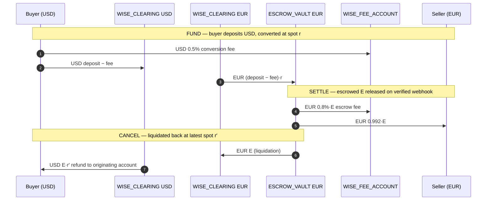

# Wise Smart Escrow

A conditional B2B settlement layer operating on simulated Electronic Money
Institution (EMI) rails. Java 21 + Spring Boot 3 backend, PostgreSQL via
Spring Data JPA/Flyway, JWT authentication, and a React + Vite multi-tenant
SaaS dashboard styled with Wise Neptune tokens.

## Repository layout

```
backend-java/            Active service — Spring Boot 3 / Java 21
frontend/                Multi-tenant SaaS dashboard — React 19 + Vite
Makefile                 Unified install/build/test/run targets
docker-compose.yml       Local Postgres for development
render.yaml              One-click backend deployment (Render)
```

## Architecture (backend-java/)

```
infrastructure/web/         Thin controllers — DTO validation + HTTP only.
application/service/        Domain orchestration: EscrowService, LedgerService.
application/dto/            Wire DTOs (snake_case JSON, money as strings).
domain/                     Aggregates, value objects, typed exceptions.
infrastructure/persistence/ JPA entities + repository adapters (ports).
infrastructure/security/    JWT resource server, idempotency filter, CORS.
```

Core invariants:

- **No float for money.** All amounts are `BigDecimal` / JSR 354
  `MonetaryAmount` (Moneta). Wire format carries money as JSON strings.
- **Double-entry only.** Balances change exclusively via balanced
  `LedgerTransaction` legs inside one atomic commit. Every leg is
  SHA-256 hash-chained for tamper-evident audit.
- **UBO anti-collusion.** `buyer.ubo_tax_id == seller.ubo_tax_id` → HTTP 403
  (`CIRCULAR_OWNERSHIP_DETECTED`). Tax IDs are AES-256-GCM encrypted at rest.
- **Convert first, then freeze.** Deposits convert at spot immediately;
  the vault always holds the target invoice currency.
- **Webhook-gated release.** `FUNDED → SETTLED` only via a merged GitHub PR
  or a `DHL / DELIVERED` carrier event, verified by `X-Hub-Signature-256`
  HMAC. There is no manual/admin settle path.
- **Asymmetric cancellation.** Target funds liquidate back to source at the
  _latest_ spot rate; the buyer absorbs FX losses; funds return only to the
  originating account.
- **Idempotent mutations.** Raw `Authorization`-header-keyed idempotency
  records dedupe retries; auth routes are excluded; bodies over 64 KB are
  rejected with 413.

## Double-entry clearing ledger

Cross-currency flows decompose into same-currency legs routed through
`WISE_CLEARING_ACCOUNT` (Wise's settlement float — may run a net position).



## API surface

| Method | Path                              | Purpose                                          |
| ------ | --------------------------------- | ------------------------------------------------ |
| POST   | `/api/v1/auth/register`           | Register org + user (sandbox balances seeded)    |
| POST   | `/api/v1/auth/login`              | JWT bearer token                                 |
| GET    | `/api/v1/auth/me`                 | Current user + entity profile                    |
| GET    | `/api/v1/accounts`                | Tenant account balances                          |
| GET    | `/api/v1/escrow`                  | List contracts (role-scoped)                     |
| GET    | `/api/v1/escrow/counterparty`     | Resolve counterparty by business email           |
| GET    | `/api/v1/escrow/quote`            | Spot quote + Wise-vs-bank cost comparison        |
| POST   | `/api/v1/escrow`                  | Create contract (UBO check; 202 invite if new)   |
| GET    | `/api/v1/escrow/{id}`             | Contract detail                                  |
| GET    | `/api/v1/escrow/{id}/audit`       | Ledger legs for the contract                     |
| POST   | `/api/v1/escrow/{id}/fund`        | Buyer deposit → convert → vault (FUNDED)         |
| POST   | `/api/v1/escrow/{id}/cancel`      | Asymmetric cancellation (buyer only)             |
| POST   | `/webhooks/github`                | Signed PR-merge release                          |
| POST   | `/webhooks/logistics`             | Signed carrier-delivery release                  |
| GET    | `/actuator/health`                | Liveness/readiness                               |

## Run locally

```bash
make install        # gradle build + npm install + playwright browsers
make db             # local Postgres via docker compose
JWT_SECRET=$(openssl rand -hex 32) make run-backend   # → http://localhost:8080
make run-frontend                                     # → http://localhost:5173
```

On first boot against an empty database the `SeedRunner` provisions demo
entities and balances (`WISE_SEED_*` envs control this). All configuration
keys are documented in `.env.example`.

## Testing

```bash
make test       # gradlew clean test (Testcontainers + real Postgres) + e2e
make test-e2e   # Playwright SaaS flow: register → fund → webhook settle
```

- `DomainInvariantPropertyTest` — jqwik property tests (ledger conservation,
  non-negative accounts, state-machine rigidity, cent-exact splits).
- `EscrowApiIntegrationTest` — MockMvc full lifecycle, UBO rejection,
  tenant isolation, webhook signature rejection.
- `EscrowConcurrencyTest` — funding/settlement races on real Postgres locks.
- `frontend/e2e` — Playwright against the live Spring Boot stack.

## Deployment

Live components:

- **Frontend (Vercel)**: https://wise-escrow.vercel.app
- **Database (Supabase)**: project `wise-escrow` (`fxxxkctszerxgkyqeeqn`,
  eu-west-1) — schema + demo tenants already migrated and seeded.
  Demo logins: `buyer@wise.demo` / `seller@wise.demo` (password `demo1234`).
- **Backend (Render)**: one-click blueprint deploy —

  [](https://render.com/deploy?repo=https://github.com/unnobatroo/wise-hack)

  `render.yaml` provisions the `wise-escrow-backend` web service
  (Docker, port 8080, health `/actuator/health`). Fill the `sync: false`
  env vars in the Render dashboard:

  | Env var | Value |
  |---|---|
  | `SPRING_DATASOURCE_URL` | `jdbc:postgresql://db.fxxxkctszerxgkyqeeqn.supabase.co:5432/postgres?sslmode=require` |
  | `SPRING_DATASOURCE_USERNAME` | `postgres` |
  | `SPRING_DATASOURCE_PASSWORD` | Supabase project DB password |
  | `JWT_SECRET` | ≥32 random bytes |
  | `WISE_FIELD_ENCRYPTION_KEY` | base64-encoded 32-byte AES key |
  | `WISE_GITHUB_WEBHOOK_SECRET` | HMAC secret for PR-merge releases |
  | `WISE_LOGISTICS_WEBHOOK_SECRET` | HMAC secret for carrier releases |

  `WISE_SEED_ENABLED=true` and `WISE_CORS_ORIGINS=https://wise-escrow.vercel.app`
  are preset in the blueprint. The frontend's `VITE_API_BASE_URL` already
  points at `https://wise-escrow-backend.onrender.com`.

See `.env.example` for the full variable reference.
