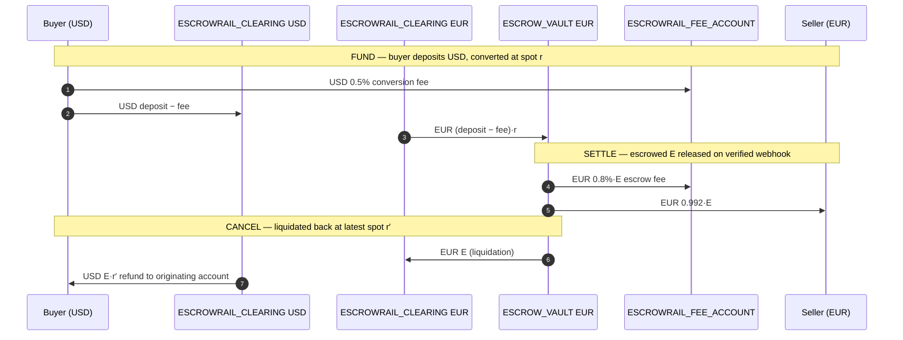

# Escrowrail

A conditional B2B settlement layer operating on simulated Electronic Money
Institution (EMI) rails. FastAPI + SQLModel/SQLite, strict layered clean
architecture, `Decimal`-only money, and a balanced double-entry ledger.

## Architecture

```
routers/      Thin controllers — schema validation + HTTP serialization only.
services/     Domain orchestration: EscrowService, LedgerService, FXService.
repositories/ Data access + transaction boundaries. No business rules.
models/       SQLModel tables + state machine enums.
dependencies.py  FastAPI Depends wiring — services are never constructed
              inside route handlers (tests override get_session/get_fx_provider).
exceptions.py Typed domain errors → uniform JSON: {error_code, message, context}.
```

Core invariants:

- **No float for money.** All amounts are `Decimal` (SQL `Numeric(20,2)`),
  rates `Numeric(20,8)`. `record_transfer` rejects non-`Decimal` input.
- **Double-entry only.** Balances change exclusively via balanced
  `LedgerTransaction` legs inside an atomic commit.
- **UBO anti-collusion.** `buyer.ubo_tax_id == seller.ubo_tax_id` → HTTP 403
  (`CIRCULAR_OWNERSHIP_DETECTED`).
- **Convert first, then freeze.** Deposits convert at spot immediately;
  the vault always holds the target invoice currency.
- **Webhook-gated release.** `FUNDED → SETTLED` only via a merged GitHub PR
  or a `DHL / DELIVERED` carrier event.
- **Asymmetric cancellation.** Target funds liquidate back to source at the
  _latest_ spot rate; the buyer absorbs FX losses; funds return only to the
  originating account.

## Double-entry clearing ledger

Cross-currency flows decompose into same-currency legs routed through
`ESCROWRAIL_CLEARING_ACCOUNT` (Escrowrail's settlement float — may run a net position).



Every leg is a `LedgerTransaction(debit, credit, amount, currency)` —
debits always equal credits, so the sum of all balances per currency is
conserved (≡ 0 when everything starts at 0).

## API

| Method | Path                                         | Purpose                                               |
| ------ | -------------------------------------------- | ----------------------------------------------------- |
| POST   | `/entities`                                  | Register a legal entity (`ubo_tax_id`, `country`)     |
| GET    | `/entities/{id}`                             | Fetch entity                                          |
| POST   | `/accounts`                                  | Open a currency account (+optional `initial_balance`) |
| GET    | `/accounts/{id}` / `/accounts/{id}/ledger`   | Balance / ledger history                              |
| POST   | `/contracts`                                 | Create escrow contract (INITIATED; UBO check here)    |
| GET    | `/contracts/{id}` / `/contracts/{id}/ledger` | Contract / its ledger legs                            |
| POST   | `/contracts/{id}/fund`                       | Buyer deposit → convert → vault (FUNDED)              |
| POST   | `/contracts/{id}/cancel`                     | Asymmetric cancellation (latest spot)                 |
| POST   | `/webhooks/github`                           | PR merge release (`action: closed`, `merged: true`)   |
| POST   | `/webhooks/logistics`                        | Carrier release (`carrier: DHL`, `status: DELIVERED`) |

## Run locally

```bash
python3 -m venv .venv && source .venv/bin/activate
make install          # pip install -e ".[dev,test]"
make seed             # demo entities/accounts (prints IDs)
make run              # uvicorn app.main:app --reload  → http://localhost:8000/docs
```

All config keys are optional — see `.env.example`. `make check` runs the full
gate: `ruff check`, `ruff format --check`, `mypy --strict`, `pytest`, and the
Hypothesis invariant suite (`tests/test_invariants.py`).

## Manual testing with cURL

```bash
B=http://localhost:8000

# UBO collision — same ubo_tax_id on both sides → 403
BUYER=$(curl -s $B/entities -H 'content-type: application/json' \
  -d '{"legal_name":"Acme US","ubo_tax_id":"TAX-US-1001","country":"US"}' | jq -r .id)
SUB=$(curl -s $B/entities -H 'content-type: application/json' \
  -d '{"legal_name":"Acme DE","ubo_tax_id":"TAX-US-1001","country":"DE"}' | jq -r .id)
curl -s -X POST $B/contracts -H 'content-type: application/json' -d "{
  \"buyer_id\":\"$BUYER\",\"seller_id\":\"$SUB\",\"target_currency\":\"EUR\",
  \"target_amount\":\"1000\",\"source_currency\":\"USD\",
  \"tracking_type\":\"GITHUB_PR\",\"tracking_key\":\"x\"}"
# → {"error_code":"ERR_CIRCULAR_OWNERSHIP","code":"CIRCULAR_OWNERSHIP_DETECTED",...}

# Real seller + fund a contract
SELLER=$(curl -s $B/entities -H 'content-type: application/json' \
  -d '{"legal_name":"Berlin Robotics","ubo_tax_id":"TAX-DE-2002","country":"DE"}' | jq -r .id)
BUYER_ACC=$(curl -s $B/accounts -H 'content-type: application/json' \
  -d "{\"entity_id\":\"$BUYER\",\"currency\":\"USD\",\"initial_balance\":\"50000\"}" | jq -r .id)
SELLER_ACC=$(curl -s $B/accounts -H 'content-type: application/json' \
  -d "{\"entity_id\":\"$SELLER\",\"currency\":\"EUR\"}" | jq -r .id)
CID=$(curl -s $B/contracts -H 'content-type: application/json' -d "{
  \"buyer_id\":\"$BUYER\",\"seller_id\":\"$SELLER\",\"target_currency\":\"EUR\",
  \"target_amount\":\"10000\",\"source_currency\":\"USD\",\"tracking_type\":\"GITHUB_PR\",
  \"tracking_key\":\"https://github.com/acme/repo/pull/42\"}" | jq -r .id)
curl -s -X POST $B/contracts/$CID/fund -H 'content-type: application/json' \
  -d "{\"account_id\":\"$BUYER_ACC\",\"deposit_amount\":\"11000\"}"

# Release via GitHub PR merge webhook
curl -s -X POST $B/webhooks/github -H 'content-type: application/json' -d '{
  "action":"closed",
  "pull_request":{"merged":true,"html_url":"https://github.com/acme/repo/pull/42"}}'
# → {"status":"settled","contract_id":"..."}

curl -s $B/accounts/$SELLER_ACC   # seller credited 99.2% of escrowed EUR
curl -s $B/contracts/$CID/ledger  # full audit trail of every leg
```

## Testing

- `make test` — unit + API integration suite.
- `make test-invariants` — Hypothesis property tests: ledger-replay
  conservation, clearing nets to zero after complete cycles, state-machine
  rigidity via a `RuleBasedStateMachine`, and cent-exact fee/rounding splits.
- `pip-audit --desc --skip-editable` — dependency vulnerability gate (CI).
