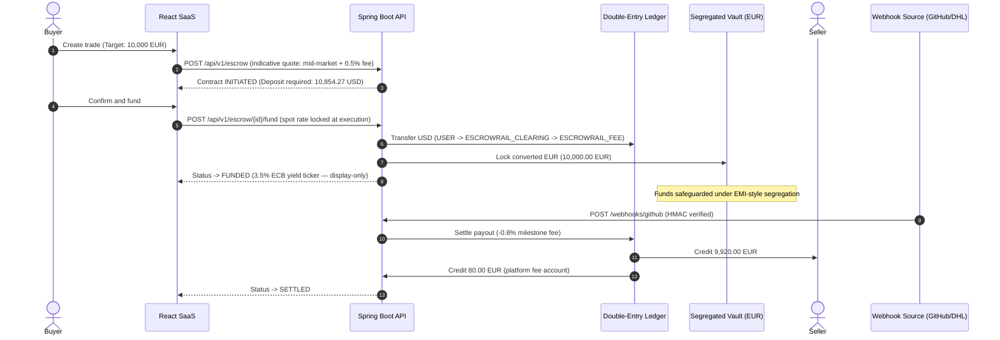

# Escrowrail

Escrowrail is a B2B conditional-settlement platform — escrow-as-a-service
for cross-border trade. A Java 21 / Spring Boot 3.5 API, a React 19 /
TypeScript dashboard, and a PostgreSQL double-entry ledger. Everything in
the repo is real: exact decimal money, row-level locking, cryptographically
verified settlement, hash-chained audit records.

## Live environments

| Surface              | Provider             | URL                                                                                                 |
| -------------------- | -------------------- | --------------------------------------------------------------------------------------------------- |
| **Frontend Web App** | Vercel               | <https://escrowrail.vercel.app>                                                                    |
| **Backend REST API** | Azure Container Apps | <https://escrowrail-api.redmoss-f42ffb4e.swedencentral.azurecontainerapps.io> (`/actuator/health`) |
| **Database**         | Supabase             | Managed PostgreSQL 16 (SSL enabled)                                                                 |
| **Documentation**    | GitHub Wiki          | [Wiki](https://github.com/unnobatroo/escrowrail/wiki) — mirrored from `docs/wiki/`                  |

## The problem

Two companies in different countries want to trade. The seller won't ship
goods or deploy code without guaranteed payment. The buyer won't prepay,
because recovering money across jurisdictions is slow, expensive, and often
impossible. The traditional fixes — letters of credit, escrow agents —
charge 3–4% in FX markups plus wire fees on every leg and take days to
confirm.

## What Escrowrail does

The buyer deposits funds, which convert immediately at mid-market FX into
the seller's currency and lock inside a segregated, per-contract vault
account. The vault releases only when a **cryptographically verified
third-party event** arrives — a merged GitHub pull request for software, a
carrier delivery scan for goods. No human approves settlement; there is no
API endpoint a user can call to settle a trade.

- **0.5% conversion fee** at funding, shown up front in the quote
- **0.8% milestone fee** at settlement — 99.2% of the vault goes to the seller
- **0.0% FX markup** — conversion happens at mid-market, the honest midpoint

## How a trade flows



The lifecycle is `INVITED → INITIATED → FUNDED → SETTLED` (or `CANCELLED`
before settlement). Trades address counterparties by business email: if the
address isn't registered yet, the contract waits in `INVITED` and attaches
automatically once that person signs up and verifies their email. Any
registered entity can be buyer on one trade and seller on the next — roles
are per contract, never global. Two entities sharing a UBO tax ID can't
trade with each other; that's self-dealing, and creation is rejected with
HTTP 403.

## Architecture at a glance

- **`backend-java/`** — hexagonal Spring Boot service. `domain/` holds pure
  aggregates and repository interfaces; `application/` holds use-case
  services, ports, and events; `infrastructure/` holds JPA adapters,
  controllers, mail, and security. Money is JSR-354 Moneta (`BigDecimal`,
  `HALF_EVEN`, scale ≤ 2); events ride Spring Modulith's transactional
  outbox; every mutation takes `SELECT … FOR UPDATE` locks in
  ascending-UUID order.
- **`frontend/`** — React 19 SPA, Vite + Tailwind + Framer Motion,
  organized by feature (`escrow-trades/{dashboard,drawer,create}`,
  `authentication`, `ledger-activity`, `company-profile`, `shared/`).
  Money arrives and leaves as strings; the browser never does arithmetic.
- **`docs/wiki/`** — the deep dives: [business model](docs/wiki/Home.md),
  [architecture](docs/wiki/System-Architecture.md),
  [ledger internals](docs/wiki/Ledger-and-Financial-Integrity.md),
  [security](docs/wiki/Security-and-Cryptography.md),
  [deployment](docs/wiki/Deployment-and-Operations.md).

## Honest disclosures

- `StaticFxRateProvider` serves a deterministic mid-market table
  (1 USD = 0.9259259 EUR) so every environment computes identically —
  swapping in a live rate provider is a one-class change.
- The float-yield ticker (3.5% ECB annualized) is display-only; it models
  EMI economics, no ledger entries are written for it.
- `/api/v1/demo/**` exists only under the `demo` profile and exposes a
  server-side webhook simulator that signs through the real HMAC path.
  The `prod` profile compiles none of it.

## Local quickstart

```bash
make install        # backend build + npm install + Playwright browsers
make db             # local Postgres via docker compose
make run-backend    # dev profile: seeded tenants + demo tools
make run-frontend   # Vite dev server → http://localhost:5173
make test           # backend Testcontainers suite + Playwright e2e
```

Seeded personas (dev/demo): `buyer@demo.com` (50k USD) and
`seller@demo.com` (10k EUR). Passwords come from `DEMO_BUYER_PASSWORD` /
`DEMO_SELLER_PASSWORD`; unset, a random one is generated per boot and
logged. The navbar has a one-click persona switcher.

## Contributing

All changes land via PR — see [CONTRIBUTING.md](CONTRIBUTING.md). The
definition of done is the full gate: `./gradlew clean check`,
`npm run build`, `npx playwright test`.
