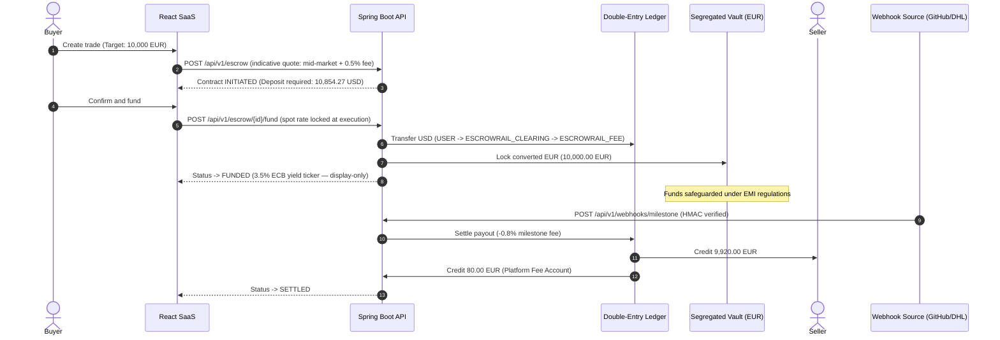
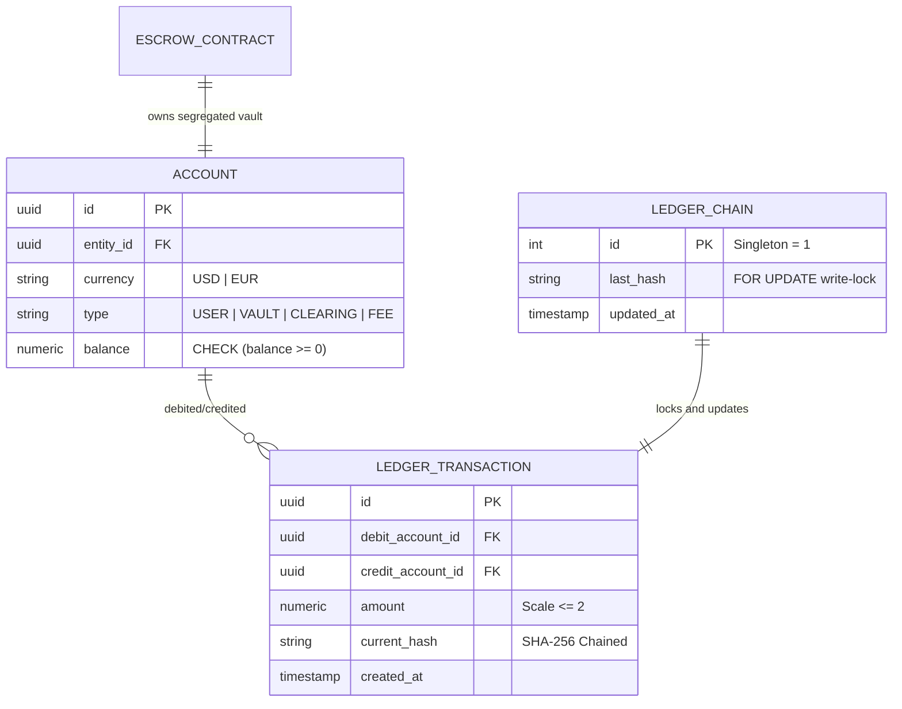

# Escrowrail

[](https://github.com/unnobatroo/escrowrail/actions/workflows/ci.yml)
[](https://openjdk.org/projects/jdk/21/)
[](https://spring.io/projects/spring-boot)
[](https://react.dev/)
[](https://vitejs.dev/)
[](https://tailwindcss.com/)
[](https://www.postgresql.org/)
[](LICENSE)

An enterprise B2B conditional settlement platform that combines mid-market
foreign-exchange rails with automated milestone-based escrow vaults —
Java 21 / Spring Boot 3.5 backend, React 19 / TypeScript dashboard,
PostgreSQL double-entry ledger.

## Live environments

| Surface              | Provider             | URL                                                                                                 | Status                                       |
| -------------------- | -------------------- | --------------------------------------------------------------------------------------------------- | -------------------------------------------- |
| **Frontend Web App** | Vercel               | <https://escrowrail.vercel.app>                                                                    | Production                                   |
| **Backend REST API** | Azure Container Apps | <https://escrowrail-api.redmoss-f42ffb4e.swedencentral.azurecontainerapps.io> (`/actuator/health`) | Production                                   |
| **Database**         | Supabase             | Managed PostgreSQL 16 (SSL enabled)                                                                 | Active                                       |
| **Documentation**    | GitHub Wiki          | [Wiki](https://github.com/unnobatroo/escrowrail/wiki) (`docs/wiki/` in-repo)                         | Live                                         |

## The commercial deadlock

Cross-border business transactions suffer an inherent counterparty deadlock.
A seller will not ship goods or deploy proprietary code without guaranteed
payment; a buyer will not wire funds upfront because recovering assets
across jurisdictions is slow, expensive, and often impossible. The legacy
escape hatches — letters of credit and traditional escrow agents — charge
opaque 3–4% FX markups, levy wire fees on every leg, and take days to
confirm what a signed webhook proves in seconds.

## The Escrowrail solution

Applying Electronic Money Institution mechanics: when a buyer funds a
contract, the deposit converts immediately at mid-market spot for a
transparent 0.5% fee, and the proceeds land in a segregated per-contract
vault — never lent, never leveraged, never pooled. Settlement requires no
human approval: a cryptographically verified third-party event (a merged
GitHub pull request, a carrier delivery confirmation) releases the vault —
99.2% to the seller, 0.8% as the platform milestone fee. Every balance
movement is a balanced double-entry row in a SHA-256 hash-chained ledger.

## How it works



The lifecycle is `INVITED → INITIATED → FUNDED → SETTLED` (or `CANCELLED`
before settlement). Any registered entity can buy on one contract and sell
on the next — permissions are per contract, never global. A trade addressed
to an unregistered email persists as `INVITED` and attaches automatically
when that address signs up and verifies. Circular ownership — buyer and
seller sharing a UBO tax ID — is rejected with HTTP 403 at creation time.

## Technical architecture



- **Backend** (`backend-java/`): Spring Boot 3.5 / Java 21, layered
  `domain.model` aggregates / `application.service` orchestrators /
  `infrastructure` adapters / `infrastructure.web` controllers. Money is
  JSR 354 Moneta with `HALF_EVEN` rounding and scale≤2 enforced in the
  domain; event delivery uses the Spring Modulith transactional outbox;
  concurrency relies on `SELECT … FOR UPDATE` locks taken in ascending-UUID
  order.
- **Frontend** (`frontend/`): React 19, TypeScript, Vite, Tailwind with
  Escrowrail design tokens, Framer Motion (reduced-motion aware), feature-based
  layout (`features/escrow-trades`, `features/authentication`,
  `features/ledger-activity`, `features/company-profile`, `shared/`).
- **Disclosures**: `StaticFxRateProvider` serves a deterministic mid-market
  table (1 USD = 0.9259259 EUR) for reproducible evaluation — `fundContract`
  locks the spot rate at deposit execution, and the quote is indicative.
  `/api/v1/demo/config` is unauthenticated by design under the `demo`
  profile (account switching, simulated webhook dispatch); the `prod`
  profile excludes `DemoToolsController` entirely.

## Local quickstart

```bash
make install        # backend build + npm install + Playwright browsers
make db             # local Postgres via docker compose
make run-backend    # boots the dev profile (seeded tenants, demo tools)
make run-frontend   # Vite dev server
make test           # backend Testcontainers suite + Playwright e2e
```

Seeded demo accounts (dev/demo profiles): `buyer@demo.com` /
`seller@demo.com`. Passwords come from `DEMO_BUYER_PASSWORD` /
`DEMO_SELLER_PASSWORD` — unset, a random one is generated per boot and
logged. A one-click account switcher in the navbar toggles between them.

## Documentation

Full product and engineering documentation lives in `docs/wiki/` (and on
the GitHub Wiki once enabled):

- [Overview & Business Model](docs/wiki/Home.md)
- [System Architecture](docs/wiki/System-Architecture.md)
- [Financial Core & Ledger](docs/wiki/Ledger-and-Financial-Integrity.md)
- [Security & Cryptography](docs/wiki/Security-and-Cryptography.md)
- [Deployment & Operations](docs/wiki/Deployment-and-Operations.md)
