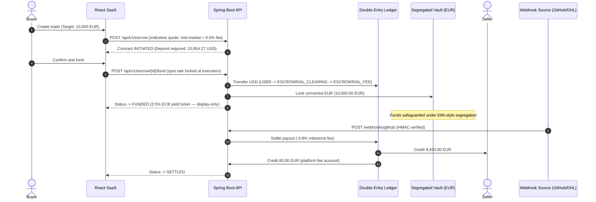

# Overview & Business Model

## The commercial problem

Two companies in different countries want to do business, and neither can
afford to go first.

The seller's position: ship the goods or deploy the software, then invoice —
and if the buyer never pays, the only recourse is cross-border litigation,
which is slow, expensive, and often not worth the claim. The buyer's
position: wire the money upfront — and if the seller never delivers, the
same broken recovery path applies in reverse.

The traditional escape hatches exist but are priced for a different era:
letters of credit and legacy escrow agents charge opaque 3–4% FX markups,
levy wire fees on every leg, and rely on manual paper processing that takes
days to confirm what a signed webhook proves in seconds.

## What Escrowrail does about it

Escrowrail borrows the mechanics of an Electronic Money Institution and
applies them to the trade itself.

**Convert first, then freeze.** When the buyer funds a contract, the
deposit is converted *immediately* at the true mid-market rate — the
midpoint between global buy and sell prices, no spread added — for a
transparent 0.5% conversion fee. The converted amount lands in a segregated
vault account created for that one contract: ring-fenced from operational
assets, never lent, never leveraged, never pooled. Because the conversion
happens at funding, the seller's payout is denominated and fixed the moment
money moves — neither party is exposed to FX drift while work is underway.

**Settlement is an event, not a decision.** Each contract binds to a
verifiable real-world milestone — a merged GitHub pull request for software
delivery, or a carrier delivery confirmation for physical goods. When the
provider emits a cryptographically signed (HMAC-SHA256) webhook, the
platform settles without human approval: 99.2% of the vaulted amount goes
to the seller, and the platform retains a 0.8% milestone fee. There is no
"release funds" button anywhere in the product.

## The lifecycle

A trade that names an unregistered counterparty doesn't fail — it persists
in `INVITED` status and attaches automatically when that email completes
registration and verification. A funded trade can still be cancelled, but
only by the buyer, and the vault liquidates at current spot — the buyer
absorbs whatever the FX market moved since funding. The asymmetry is
deliberate: the seller committed work against a funded contract and can't
have the floor pulled out for free.

## What each party gets

- **Buyer** — verifiable delivery. Funds exist and are provably locked, but
  the seller cannot touch them until an independent third party attests the
  milestone.
- **Seller** — verifiable payment. The moment a contract is funded, the
  money is provably in escrow in the seller's own currency. No chasing
  invoices, no chargeback risk, no dependence on a foreign court.
- **Both** — a hash-chained audit trail where every balance movement is a
  tamper-evident double-entry record that either side can verify.

## Where the platform earns

| Moment | Fee | Note |
| --- | --- | --- |
| Funding | 0.5% of converted amount | Transparent, shown in the quote up front |
| Settlement | 0.8% of vaulted amount | Charged at release, never before |
| Float | ~3.5% annualized (modeled) | Display-only ticker illustrating EMI economics |
