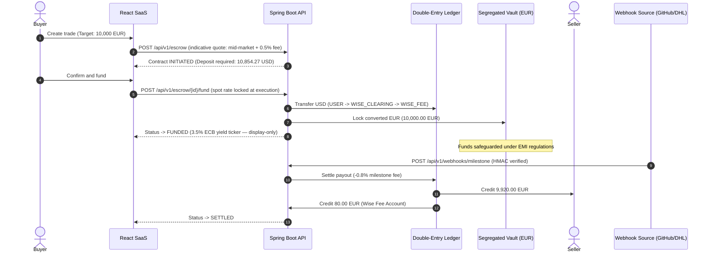

# Wise Smart Escrow

## The commercial problem

Cross-border business transactions suffer from an inherent counterparty deadlock. A seller will not ship goods or deploy proprietary code without guaranteed payment, while a buyer refuses to wire funds upfront because recovering assets across jurisdictions is slow, expensive, and often impossible. The traditional escape hatches — letters of credit, documentary collections, and legacy escrow agents — were designed for a slower era. They charge opaque foreign-exchange markups of 3% to 4%, levy wire fees on every leg, and depend on manual paper processing that takes days to confirm what a webhook can prove in seconds.

## The Wise solution

Wise Smart Escrow resolves the deadlock by borrowing the mechanics of an Electronic Money Institution. When a buyer funds a contract, the deposit is converted immediately at the true mid-market rate — the midpoint between global buy and sell prices with no added spread — and charged a transparent 0.5% conversion fee. The converted amount lands in a segregated vault account per contract: ring-fenced from operational assets, never lent, never leveraged, never pooled.

Settlement is conditional and automatic, not manual. Each contract is bound to a verifiable real-world milestone — a merged GitHub pull request for software delivery, or a carrier delivery confirmation for physical goods. When the provider emits a cryptographically signed webhook, the platform settles without human approval: 99.2% of the vaulted amount disburses to the seller, and the platform retains a 0.8% milestone fee.

## The lifecycle

## What the buyer and seller each get

The buyer gets verifiable delivery: funds exist and are locked, but the seller cannot touch them until an independent third party attests the milestone. The seller gets verifiable payment: the moment the contract is funded, the money is provably in escrow — no chasing invoices, no chargeback risk, no waiting on a buyer's goodwill after delivery. Both parties get a hash-chained audit trail where every balance movement is a tamper-evident double-entry record.
