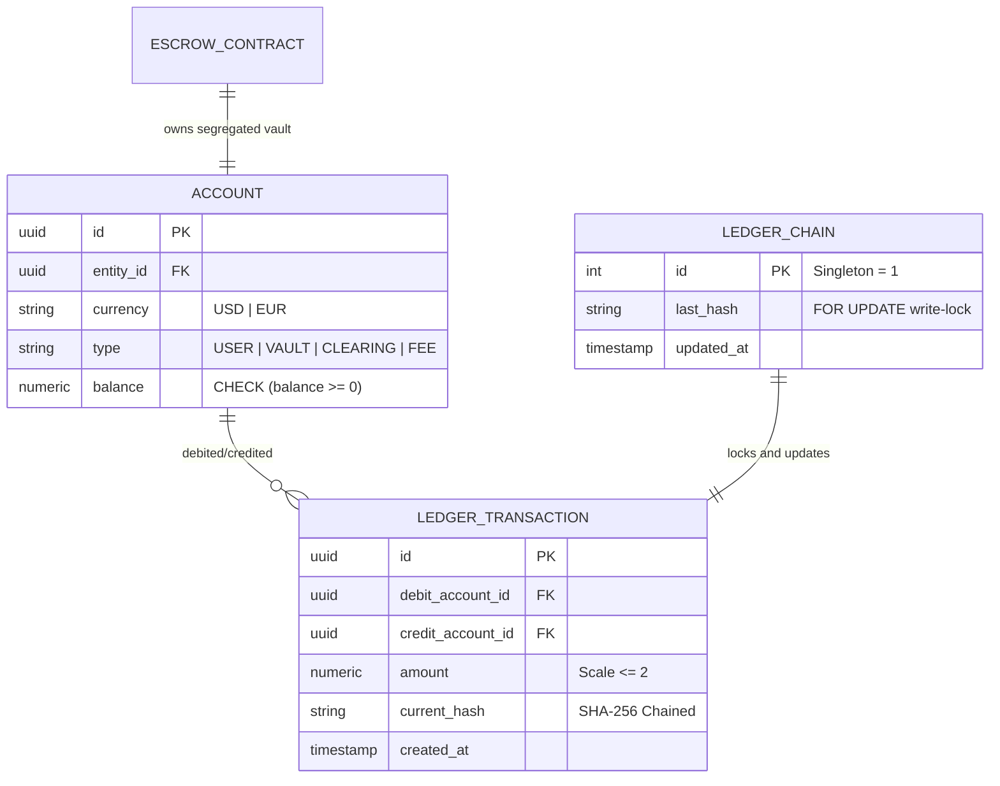

# Financial Core & Ledger Integrity

## Double-entry accounting

A single mutable balance column is unacceptable in a financial system: it records that money moved but never where it came from, where it went, or whether the movement was ever balanced. Every funds movement on this platform is one atomic debit→credit pair recorded in `ledger_transactions` — the debited account, the credited account, the exact amount, and a hash chained to every prior entry. Account types make the flow legible: `USER_ACCOUNT` holds customer funds, `ESCROW_VAULT` holds one contract's segregated balance, `WISE_FEE` collects the platform's take, and `WISE_CLEARING` is the house bridge that every cross-currency conversion passes through. Within any transaction the legs always net to zero; a jqwik property test proves the double-entry sum invariant holds under randomized inputs.

The schema that backs it:

## Exact decimal arithmetic

IEEE 754 floating point cannot represent most decimal fractions — `0.1` is a repeating binary fraction — so a `double` accumulator silently drifts real money. All monetary logic runs through JSR 354 Moneta (`MonetaryAmount`) over `BigDecimal`, rounded with `RoundingMode.HALF_EVEN` (banker's rounding, which does not systematically bias toward the house over large volumes). User-facing inputs with more than two decimal places are rejected outright — both at the service boundary and inside `Account.assertCentScale` — so a fractional-cent amount can never reach Postgres, where `numeric(20,2)` would otherwise round it HALF_UP and silently change the amount. There is zero client-side arithmetic on the frontend; every number the browser displays was computed server-side.

## Convert-then-freeze

Funding converts currency at deposit time, not at settlement time. The buyer's deposit minus the 0.5% conversion fee is converted at the live spot rate and vaulted in the target currency immediately. This matters: between funding and milestone completion, the seller's payout is denominated and fixed — neither party is exposed to FX movement while work is underway. The trade-off, absorbed deliberately, is that the spot rate locked is the rate *at funding execution*, not at quote time; the quote is indicative and the fund call re-reads the provider. `StaticFxRateProvider` currently serves a deterministic mid-market table (1 USD = 0.9259259 EUR) so every environment computes identically — swapping in a live provider is a one-class change.

## Asymmetric cancellation

Only the buyer may cancel, and only before settlement. An `INITIATED` cancellation is free. A `FUNDED` cancellation liquidates the vault at the *current* spot rate back into source currency: the buyer absorbs whatever FX drift occurred since funding, and the platform retains the original 0.5% conversion fee. The asymmetry is deliberate — the seller committed deliverable work against a funded contract and cannot have the floor pulled out unilaterally.

## Float interest

While EUR sits vaulted, it accrues a simulated float yield at 3.5% annualized, interpolated continuously on the dashboard ticker. This mirrors the real EMI economics of safeguarded balances; it is a display model, not a ledger movement — no yield entries are written.

## Anti-collusion

At contract creation, the buyer's and seller's normalized UBO tax IDs are compared. A match throws `CircularOwnershipException` (HTTP 403) — two entities under common beneficial ownership cannot escrow between themselves, which blocks the circular transactions that make fake trade volume and self-laundering look legitimate.
