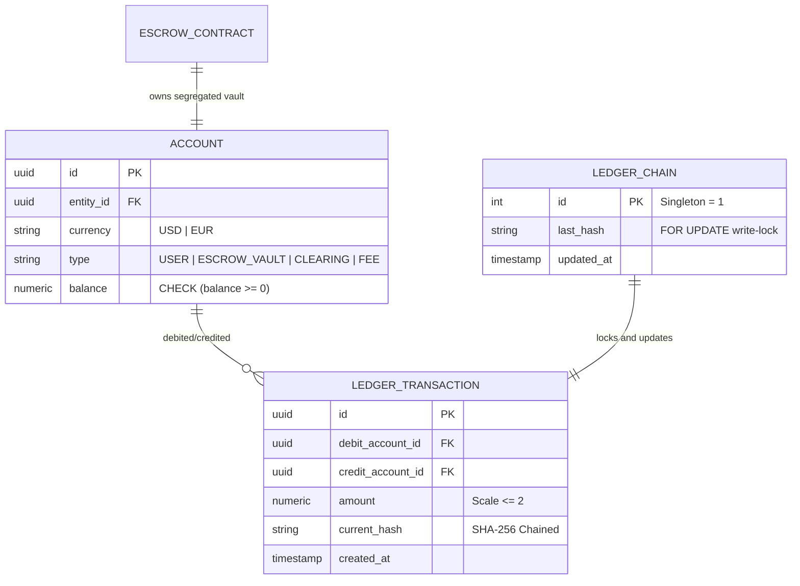

# Financial Core & Ledger Integrity

## Why double-entry, and nothing less

A single mutable `balance` column is unacceptable in a financial system. It
records that money moved but never *where it came from*, *where it went*,
or *whether the movement was ever balanced*. Every funds movement on
Escrowrail is one atomic debit→credit pair in `ledger_transactions` — the
debited account, the credited account, the exact amount — and balances are
derived, never the source of truth.

Account types make the flow legible:

| Type | What it holds |
| --- | --- |
| `USER` | A registered organization's balance, one row per currency |
| `ESCROW_VAULT` | One contract's segregated funds — created at funding, emptied at settlement |
| `ESCROWRAIL_FEE` | The platform's take — conversion fees and milestone fees |
| `ESCROWRAIL_CLEARING` | The house bridge every cross-currency conversion passes through |

Within any transaction the legs always net to zero; a jqwik property test
proves the debit-equals-credit invariant holds under randomized inputs.

## Exact decimal arithmetic

IEEE 754 floating point cannot represent most decimal fractions — `0.1` is
a repeating binary fraction — so a `double` accumulator silently drifts
real money. This system never lets that happen:

- All monetary logic runs through JSR-354 Moneta (`MonetaryAmount`) over
  `BigDecimal`, rounded `HALF_EVEN` — banker's rounding, which does not
  systematically bias toward the house over large volumes.
- Inputs with more than two decimal places are rejected outright at the
  service boundary *and* inside `Account` — so a fractional cent can never
  reach Postgres, where `numeric(20,2)` would round `HALF_UP` and silently
  change the amount.
- Money crosses the wire as **JSON strings**, and the frontend does zero
  arithmetic — every number the browser displays was computed server-side.
  Where the UI must aggregate (the dashboard totals), it sums integer cents
  via `BigInt`, never floating point.

## Convert-then-freeze

Funding converts currency at deposit time, not at settlement time. The
buyer's deposit minus the 0.5% conversion fee converts at the live spot
rate and vaults in the target currency *immediately*. This is the point of
the product: between funding and milestone completion, the seller's payout
is denominated and fixed — neither party carries FX exposure while work is
underway.

The deliberate trade-off: the locked rate is the rate **at funding
execution**, not at quote time — the quote is indicative and the fund call
re-reads the provider. `StaticFxRateProvider` currently serves a
deterministic mid-market table (1 USD = 0.9259259 EUR) so every environment
computes identically; swapping in a live provider is a one-class change
behind the `FxRateProvider` port.

## Asymmetric cancellation

Only the buyer may cancel, and only before settlement.

- **INITIATED → CANCELLED** is free — nothing has moved.
- **FUNDED → CANCELLED** liquidates the vault at *current* spot back into
  the source currency: the buyer absorbs whatever FX drift occurred since
  funding, and the platform retains the original 0.5% conversion fee.

The asymmetry is deliberate — the seller committed deliverable work against
a funded contract and cannot have the floor pulled out unilaterally.

## The hash chain — auditability you can verify

Each ledger row stores `current_hash`: SHA-256 over the previous row's hash
plus this entry's canonicalized contents (amounts at scale-2, timestamps at
microsecond precision, currency, description, contract ID — delimited so
fields can't be reinterpreted by concatenation). Mutating any historical
row breaks every subsequent link.

Under concurrency, inserts serialize on the singleton `ledger_chain` row
locked `FOR UPDATE` — the chain is linear by construction. The result is an
append-only log where tampering is detectable by recomputation, not by
trusting the operator.

## Float interest (honest disclosure)

While EUR sits vaulted, the dashboard interpolates a simulated float yield
at 3.5% annualized — mirroring how a real EMI earns on safeguarded
balances. It is a display model only: **no yield ledger entries are ever
written**.

## Anti-collusion

At contract creation *and* at invite-attach time, the parties' normalized
UBO tax IDs are compared. A match throws `CircularOwnershipException`
(HTTP 403) — two entities under common beneficial ownership cannot escrow
between themselves. That blocks the circular transactions that make fake
trade volume and self-laundering look legitimate.
