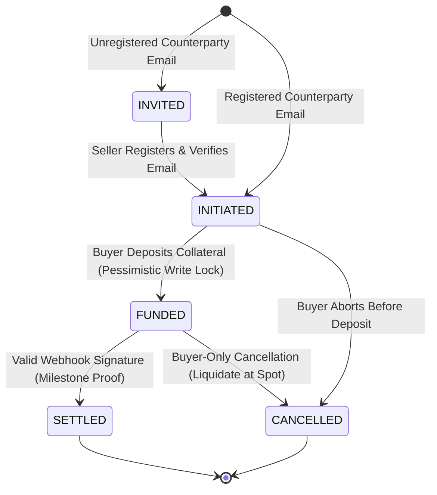

# System Architecture

## The shape of the system

Escrowrail is deliberately a **modular monolith**: two deployable units, one
database, no message bus, no microservices.

- **Backend** — Java 21 / Spring Boot 3.5, serving a versioned JSON API
  (`/api/v1/**`) and a webhook ingress (`/webhooks/**`) that is
  unauthenticated-by-design but cryptographically verified.
- **Frontend** — React 19 / TypeScript SPA built by Vite and deployed as
  static assets. It talks to the API over bearer-JWT HTTPS; there is no
  shared runtime state, no server-side session, no coupling beyond the wire
  contract.
- **Database** — PostgreSQL 16 owns *all* state. That's why the system can
  scale horizontally: any backend instance can serve any request because
  consistency is enforced by row locks and constraints in the database, not
  by coordination between nodes.

## Hexagonal layout

```
com.escrowrail/
├── config/                 Spring wiring: Jackson, encryption, seeding
├── domain/                 Pure business rules — zero Spring imports
│   ├── model/              Aggregates: Account, EscrowContract, AppUser…
│   ├── repository/         Port interfaces — what the domain asks for
│   └── exception/          Typed errors → mapped to HTTP at the edge
├── application/
│   ├── service/            Use-case orchestrators
│   ├── port/               Outbound ports: FxRateProvider,
│   │                       VerificationEmailSender
│   ├── event/              Integration events (one record per file)
│   └── dto/                Quote, FundingResult
└── infrastructure/         Everything that touches the outside world
    ├── persistence/entity/    JPA entities — the DB's shape
    ├── persistence/jpa/       Spring Data repository interfaces
    ├── persistence/adapter/   Implements domain ports via JPA
    ├── web/                   REST controllers + wire DTOs
    ├── mail/                  Resend sender + dev logging sender
    ├── security/              JWT, idempotency filter, CORS
    └── outbox/                Modulith listener → email dispatch
```

The dependency rule is strict: `domain` imports nothing from
`infrastructure`. Services depend on **interfaces** declared in
`domain/repository/`; the adapters in `infrastructure/persistence/adapter/`
implement them. The business core can be tested without a database, and the
persistence mechanism is replaceable without touching a business rule.

## Rich aggregates, thin services

Business invariants live inside the domain objects, not scattered through
procedural service code:

- **`Account`** physically cannot be debited below zero, and rejects any
  amount with more than two decimal places before it can reach Postgres's
  rounding behavior.
- **`EscrowContract`** owns its state machine — funding an already-funded
  contract or cancelling a settled one throws
  `InvalidStateTransitionException` inside the aggregate, before any
  persistence runs. An invalid state is unrepresentable, not merely
  filtered.

Services orchestrate transactions and call the aggregates; they contain no
invariants themselves. `EscrowService` is a slim coordinator — the actual
lifecycle mutations live in `EscrowFundingService`,
`EscrowSettlementService`, and `EscrowCancellationService`, quote math in
`QuoteCalculator`, and all ledger writes funnel through `LedgerService`.



## The dual-write problem, solved once

Any state change that should produce a notification faces a classic trap:
the database commit and the event dispatch are two different channels and
cannot be atomic. Commit then publish → a crash loses the event. Publish
then rollback → a phantom notification for a trade that doesn't exist.

Spring Modulith's event registry answers this with a **transactional
outbox**: the event is written into the `event_publication` table *inside
the same transaction* as the business change, then dispatched
`AFTER_COMMIT`. Invite emails, welcome emails — they can never be half a
pair. There is no custom scheduler or polling loop; the framework owns the
guarantee.

## Concurrency control

Optimistic locking is wrong for a ledger: under contention, two transfers
against the same account read the same balance, one fails a version check,
and the result is retry storms at exactly the moment the system is busiest.

Instead, every balance mutation takes `SELECT … FOR UPDATE` pessimistic
locks on the account rows. To prevent lock-ordering deadlocks — transaction
A holding account 1 wanting account 2, B holding 2 wanting 1 — **all locks
are acquired in ascending-UUID order**, both inside `LedgerService` and in
the lifecycle services that lock the full account set a transition touches.

The hash chain adds one more serialization point: a singleton
`ledger_chain` row holds `last_hash` and is locked `FOR UPDATE` on every
insert, so the audit chain is linear by construction, not by hope.

## Multi-tenancy

There are no global "buyer" or "seller" roles. Contracts associate parties
by business email resolved at creation time; permissions are evaluated per
contract by comparing the caller's `entity_id` (a JWT claim) against
`buyer_id` / `seller_id`. Any registered entity buys on one trade and sells
on the next.

Unregistered counterparties are a first-class path, not an error: the
contract persists `INVITED`, and `attachPendingInvites` fills the seller
slot inside the same transaction that activates the new verified user.

Tenant reads are scoped in the repository layer — a stranger probing a
foreign contract ID gets **404, not 403**, because even confirming the
resource exists would leak information.
